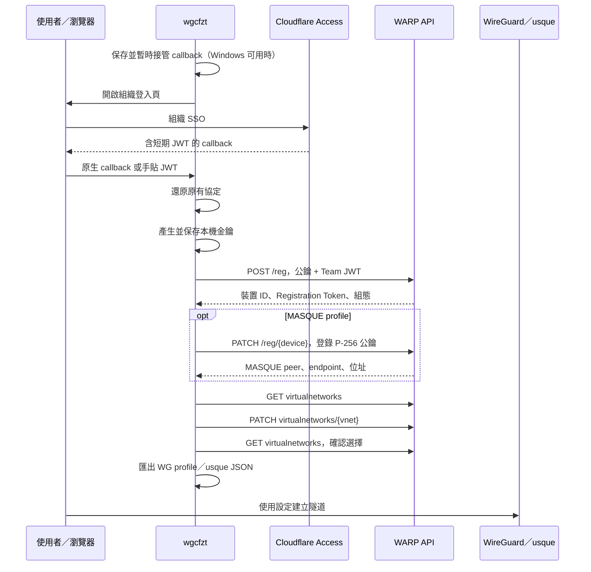
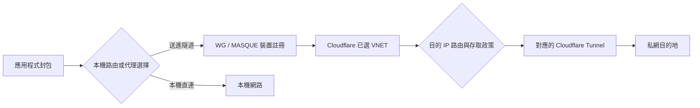

# API、Token 與路由

這份文件分別標示 client API、管理 API 與本機行為。`api.cloudflareclient.com` 是 WARP client 使用的介面，本工具使用的版本與欄位可能隨服務更新改變。

所有範例的識別碼與憑證均為 placeholder。

## 完整流程



## 1. 組織登入 JWT

```http
GET https://<TEAM>.cloudflareaccess.com/warp
```

使用者完成 SSO 後，成功頁提供：

```text
com.cloudflare.warp://<TEAM>.cloudflareaccess.com/auth?token=<JWT>
```

讀出 query 的 `token` 並 URL decode。此 JWT 用來授權新裝置註冊，不是日常 VNET API 的 bearer Token。

工具比對 callback 的 scheme、host、`/auth` 路徑與 JWT issuer，也檢查 `exp`／`nbf`。本機不持有 Access issuer 的簽章驗證邏輯；實際認證仍由 Cloudflare 執行。

## 2. 建立 WireGuard 註冊

本機產生並保存 32-byte WireGuard Curve25519 私鑰。`key` 只放對應公鑰的 Base64。

```http
POST https://api.cloudflareclient.com/v0a4471/reg
User-Agent: WARP for Android
CF-Client-Version: a-6.35-4471
CF-Access-Jwt-Assertion: <TEAM_JWT>
Content-Type: application/json; charset=UTF-8

{
  "key": "<BASE64_CURVE25519_PUBLIC_KEY>",
  "key_type": "curve25519",
  "tunnel_type": "wireguard",
  "install_id": "",
  "fcm_token": "",
  "tos": "<CURRENT_ISO8601_TIMESTAMP>",
  "model": "PC",
  "serial_number": "<RANDOM_16_HEX_CHARACTERS>",
  "os_version": "",
  "locale": "en_US",
  "name": "<OPTIONAL_DEVICE_NAME>"
}
```

回應保存：

| 欄位 | 意義 |
| --- | --- |
| `id` | 後續 API 使用的 device ID；原樣保留，不自行移除前綴 |
| `account.id` | account ID |
| `token` | 裝置 Registration Token |
| `key`、`tunnel_type` | 核對本機金鑰與註冊協定 |
| `config.interface.addresses` | 分配給此隧道的位址 |
| `config.peers` | peer 公鑰、endpoint 與候選 port |
| `policy` | 裝置政策快取，含分流與 DNS 等欄位 |

保存收到的 ID 與 Token 後，才發出下一個請求。若回應遺失，不能僅憑本機私鑰推算 Registration Token。

## 3. MASQUE enrollment

獨立 MASQUE profile 先建立註冊，再產生 P-256 金鑰並發出：

```http
PATCH https://api.cloudflareclient.com/v0a4471/reg/<DEVICE_ID>
Authorization: Bearer <REGISTRATION_TOKEN>
User-Agent: WARP for Android
CF-Client-Version: a-6.35-4471
Content-Type: application/json; charset=UTF-8

{
  "key": "<BASE64_DER_SUBJECT_PUBLIC_KEY_INFO_P256>",
  "key_type": "secp256r1",
  "tunnel_type": "masque",
  "name": "<OPTIONAL_DEVICE_NAME>"
}
```

usque 的 `private_key` 為 Base64 編碼的 SEC1 ECPrivateKey DER，而不是 PEM，也不是 WireGuard 的 32-byte raw key。peer 的 `endpoint_pub_key` 則是 API 回傳的 PEM 公鑰，用於 usque endpoint pinning。

本工具保留原 Registration Token；enrollment 回應通常沒有新的 `token`。

## 4. 查詢註冊與改名

```http
GET https://api.cloudflareclient.com/v0a4471/reg/<DEVICE_ID>
Authorization: Bearer <REGISTRATION_TOKEN>
```

`status` 使用這個端點確認 device ID、遠端公鑰與 tunnel type。回傳的政策偏好與該註冊實際 tunnel type 是不同資訊；本次環境曾在政策偏好 MASQUE 的情況下成功完成 WireGuard 握手，不代表所有組織政策都允許相同操作。

改名：

```http
PATCH https://api.cloudflareclient.com/v0a4471/reg/<DEVICE_ID>
Authorization: Bearer <REGISTRATION_TOKEN>
Content-Type: application/json; charset=UTF-8

{"name":"<DISPLAY_NAME>"}
```

改名後重新 GET 核對回應，金鑰與協定不變。

只有 usque JSON、沒有 account ID 時，其既有程式使用以下端點讀取 account：

```http
GET https://api.cloudflareclient.com/v0a4471/reg/<DEVICE_ID>/account
Authorization: Bearer <REGISTRATION_TOKEN>
```

回應的 `id` 為 account ID。wgcfzt 已將 account ID 保存在 profile，通常不需要額外查詢。

## 5. VNET 清單與切換

```http
GET https://api.cloudflareclient.com/v0/accounts/<ACCOUNT_ID>/reg/<DEVICE_ID>/virtualnetworks
Authorization: Bearer <REGISTRATION_TOKEN>
```

```json
{
  "success": true,
  "result": {
    "selected_virtual_network_id": "<CURRENT_VNET_UUID>",
    "virtual_networks": [
      {"id":"<VNET_UUID>","name":"labs","is_default_network":false}
    ]
  }
}
```

切換使用 **PATCH**，不需要 request body：

```http
PATCH https://api.cloudflareclient.com/v0/accounts/<ACCOUNT_ID>/reg/<DEVICE_ID>/virtualnetworks/<VNET_UUID>
Authorization: Bearer <REGISTRATION_TOKEN>
```

檢查 `success`，再 GET 清單確認 `selected_virtual_network_id`。PATCH 回應可能包含 `result.metadata.vn_id`，本工具以後續 GET 讀回作為確認依據。

兩類路徑的版本不同：註冊使用 `v0a4471`；這個 VNET 介面使用 `v0/accounts/...`。不要把兩者直接替換。

VNET 選擇保存在此裝置註冊。API 不會替一般 WireGuard client／usque 自動重連；請自行重新建立隧道。既有連線何時即時套用新 VNET 尚未驗證。

## 6. 解除註冊

```http
DELETE https://api.cloudflareclient.com/v0a4471/reg/<DEVICE_ID>
Authorization: Bearer <REGISTRATION_TOKEN>
User-Agent: WARP for Android
CF-Client-Version: a-6.35-4471
```

不需要 body。本工具接受 HTTP 2xx；如果回應有 `success:false`，視為失敗，不清除本機憑證。

成功後清除本機 profile 的 Token／私鑰與預設輸出檔，保留註冊已解除的紀錄。瀏覽器登入狀態不因此登出；外部設定檔複本也不會被刪除。已建立的舊隧道在何時中斷未做保證。

## 7. 三種憑證與生命週期

| 憑證 | 來源 | 用途 |
| --- | --- | --- |
| Team JWT | 組織 SSO 成功頁 | 授權 `POST /reg` |
| Registration Token | 註冊回應的 `token` | 註冊、VNET 等裝置 API |
| 隧道私鑰 | 本機產生 | WireGuard 或 MASQUE 握手 |

這次 Registration Token 是非 JWT 的 36 字元字串，註冊回應沒有 `expires_in`／`refresh_token`。這不能推導出永久有效。

目前沒有驗證到保留同一 device ID 的 Registration Token refresh／rotation 流程。切 VNET、改名、usque `enroll` 均不是已確認的 Token 更新流程。官方程式中的 `/auth` 與 API 憑證續期端點也不能直接當作 bearer Token refresh。

Token 無法使用時應先讀取 HTTP 狀態與 API error code，分辨註冊撤銷、組織政策及使用者重新認證需求。本工具只輸出 HTTP 狀態與 code，不輸出可能帶憑證的錯誤 body。

目前已驗證的重新取得方式是重新 SSO、建立**新註冊**、保存新的裝置資料，再選 VNET。不要將一般 Cloudflare Access OIDC 的 refresh token 流程套用到這個裝置 Token。

## 8. 路由在哪裡決定



本機決定封包要不要進隧道；Cloudflare 根據此註冊所選 VNET、目的 IP 及政策選擇私網 Tunnel。成功握手不表示某個私網服務必然可達。

註冊回應 `policy.include`／`exclude` 是裝置分流政策，不是每個 VNET 的完整私網路由清單。`always_include`／`always_exclude` 也不能直接當作業務私網 CIDR。

WG 設定檔預設 AllowedIPs 全通；啟用它會把相應 IP 流量交給隧道。wgcfzt 不自動套用官方 WARP 的 split tunnel 排除，也不配置本機私有 DNS。

要取得實際每 VNET 的 Tunnel 路由，可使用具有相應讀取權限的**管理 API Token**：

```http
GET https://api.cloudflare.com/client/v4/accounts/<ACCOUNT_ID>/teamnet/routes?virtual_network_id=<VNET_UUID>&is_deleted=false
Authorization: Bearer <CLOUDFLARE_MANAGEMENT_API_TOKEN>
```

這是另一個 host／API；Registration Token 不能當作一般管理 API Token。回應可用來取得 `network`、`tunnel_id`、`virtual_network_id` 等資料，並須處理分頁。可見範圍由呼叫者權限決定。

本工具目前不取得管理 API Token，也不自動下載組織路由清單。

## 9. 參考來源

- [Cloudflare Virtual Networks](https://developers.cloudflare.com/cloudflare-one/networks/virtual-networks/)
- [Cloudflare Split Tunnels](https://developers.cloudflare.com/cloudflare-one/team-and-resources/devices/cloudflare-one-client/configure/route-traffic/split-tunnels/)
- [Cloudflare Tunnel route list API](https://developers.cloudflare.com/api/resources/zero_trust/subresources/networks/subresources/routes/methods/list/)
- [wgcf API spec](https://github.com/ViRb3/wgcf/blob/master/openapi/README.md)
- [usque API implementation](https://github.com/Diniboy1123/usque/blob/main/api/cloudflare.go)
- [usque configuration loader](https://github.com/Diniboy1123/usque/blob/main/config/config.go)
