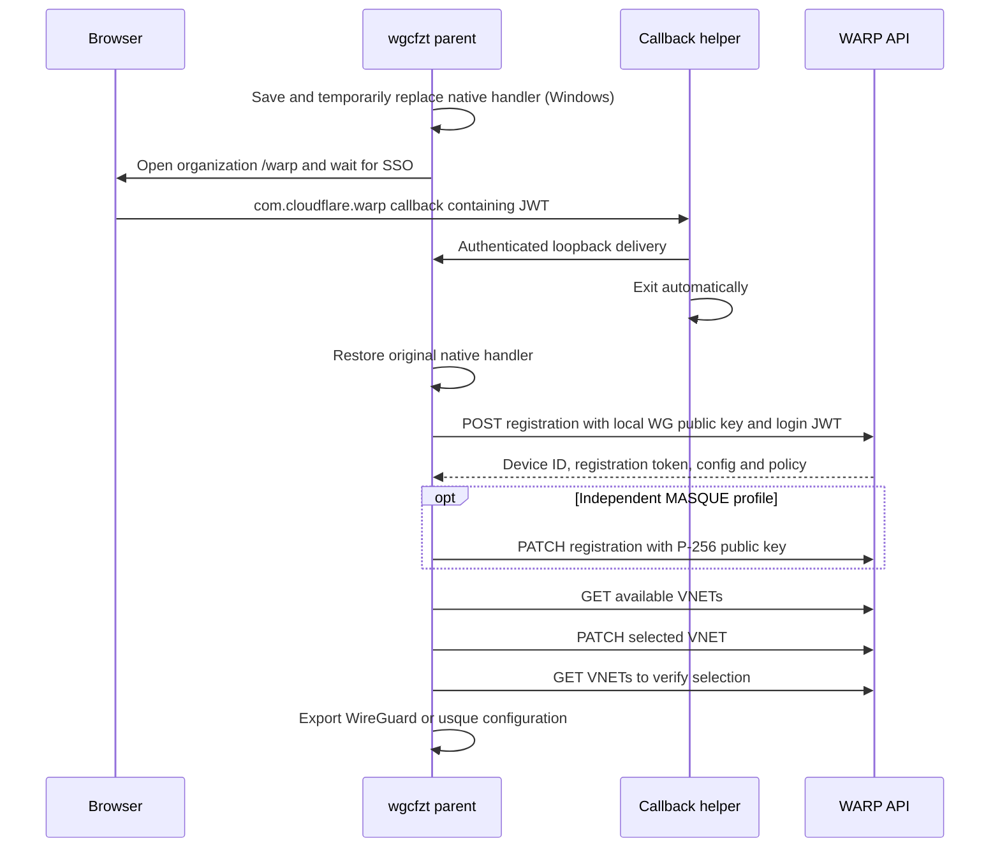

# WARP registration, VNET and routing API

This document describes the client API behavior used by wgcfzt. These endpoints are not a stable public integration contract. All identifiers and credentials below are placeholders. Enrollment and organization policies remain authoritative.

## Lifecycle



## Authentication and common headers

The browser opens:

```text
https://<TEAM>.cloudflareaccess.com/warp
```

After organization SSO, the page delivers:

```text
com.cloudflare.warp://<TEAM>.cloudflareaccess.com/auth?token=<JWT>
```

Decode the query parameter. wgcfzt validates scheme, host, path, JWT issuer, expiration, and not-before time. Local parsing does not verify the issuer's cryptographic signature; the registration server performs authentication. The login JWT is only used to create a registration.

Client API base: `https://api.cloudflareclient.com`. Common request headers:

```http
User-Agent: WARP for Android
CF-Client-Version: a-6.35-4471
Content-Type: application/json; charset=UTF-8
```

For subsequent registration and VNET requests, use `Authorization: Bearer <REGISTRATION_TOKEN>`. This is a different credential from the SSO JWT and from a Cloudflare management API token. Redirects are disabled. HTTP failures and JSON `success:false` are errors; response bodies are omitted from error messages because they may contain credentials.

## 1. Register a WireGuard device

Generate and save a 32-byte Curve25519 private key locally. Send only its Base64 public key:

```http
POST /v0a4471/reg
CF-Access-Jwt-Assertion: <TEAM_JWT>

{
  "key": "<BASE64_CURVE25519_PUBLIC_KEY>",
  "key_type": "curve25519",
  "tunnel_type": "wireguard",
  "install_id": "",
  "fcm_token": "",
  "tos": "<CURRENT_ISO8601_TIMESTAMP>",
  "model": "PC",
  "serial_number": "<RANDOM_16_HEX_CHARACTERS>",
  "os_version": "",
  "locale": "en_US",
  "name": "<OPTIONAL_DEVICE_NAME>"
}
```

Persist these response fields:

| Field | Purpose |
| --- | --- |
| `id` | Device registration ID; preserve the complete value, including any `t.` prefix |
| `account.id` | Account ID used in VNET paths |
| `token` | Registration bearer token |
| `key`, `tunnel_type` | Verify against the local key and intended protocol |
| `config.interface.addresses` | Tunnel interface IPs |
| `config.peers` | Peer public keys, endpoints and candidate ports |
| `policy` | Device policy, including split-tunnel/DNS settings when supplied |

The POST is not retried automatically. If the server creates a device but the response is lost, retrying can create a duplicate. Returned credentials are saved before further enrollment/VNET operations.

## 2. Enroll an independent MASQUE device

wgcfzt first creates a registration, then generates a separate P-256 key and submits:

```http
PATCH /v0a4471/reg/<DEVICE_ID>
Authorization: Bearer <REGISTRATION_TOKEN>

{
  "key": "<BASE64_DER_SUBJECT_PUBLIC_KEY_INFO_P256>",
  "key_type": "secp256r1",
  "tunnel_type": "masque",
  "name": "<OPTIONAL_DEVICE_NAME>"
}
```

Retain the original token if the PATCH response omits `token`. Validate the returned protocol and public key. Do not mutate a working WireGuard registration to reuse its key as a MASQUE key: the curves and private-key encodings differ.

usque JSON uses these fields:

| Field | Value |
| --- | --- |
| `private_key` | Base64 SEC1 ECPrivateKey DER for P-256 |
| `endpoint_v4`, `endpoint_v6` | API peer IP addresses, without ports |
| `endpoint_h2_v4` | `162.159.198.2` |
| `endpoint_h2_v6` | Empty string |
| `endpoint_pub_key` | API peer PEM public key for endpoint verification |
| `id`, `access_token` | Registration ID and bearer token |
| `ipv4`, `ipv6` | Assigned interface IP addresses |

There is no VNET field in this JSON. Cloudflare reads the registration's current VNET selection when handling the tunnel. Restart usque after switching.

## 3. Read or rename registration

```http
GET /v0a4471/reg/<DEVICE_ID>
Authorization: Bearer <REGISTRATION_TOKEN>
```

wgcfzt verifies device ID, remote public key, and protocol. A mismatch is an error rather than a successful status check. Status is a control-plane check, not proof of tunnel connectivity.

```http
PATCH /v0a4471/reg/<DEVICE_ID>
Authorization: Bearer <REGISTRATION_TOKEN>

{"name":"<DISPLAY_NAME>"}
```

Read back the registration after renaming. An existing client configuration without an account ID can retrieve it from `GET /v0a4471/reg/<DEVICE_ID>/account` using the same bearer token; wgcfzt normally stores it at registration time.

## 4. List and select VNETs

```http
GET /v0/accounts/<ACCOUNT_ID>/reg/<DEVICE_ID>/virtualnetworks
Authorization: Bearer <REGISTRATION_TOKEN>
```

Example response:

```json
{
  "success": true,
  "result": {
    "selected_virtual_network_id": "<CURRENT_VNET_UUID>",
    "virtual_networks": [
      {"id":"<VNET_UUID>","name":"labs","is_default_network":false}
    ]
  }
}
```

Select using **PATCH with no body**:

```http
PATCH /v0/accounts/<ACCOUNT_ID>/reg/<DEVICE_ID>/virtualnetworks/<VNET_UUID>
Authorization: Bearer <REGISTRATION_TOKEN>
```

Read the list again and compare `selected_virtual_network_id`. Do not infer selection only from a successful PATCH status. Note the path distinction: registration uses `/v0a4471/reg`, while VNET uses `/v0/accounts/...`.

VNET is per-registration server-side state, shared by every copy of that registration. The management API does not restart any local WireGuard/usque client. Reconnect the client after changing the selection. For concurrent independent VNETs, create multiple registrations with their own private keys.

## 5. Deregister

```http
DELETE /v0a4471/reg/<DEVICE_ID>
Authorization: Bearer <REGISTRATION_TOKEN>
```

No body is required. wgcfzt requires HTTP success and rejects `success:false` before clearing local token/private keys/default exports. A local tombstone remains. Exported copies outside the default profile directory must be removed separately. Do not assume an already established tunnel immediately terminates; that timing has not been verified.

## Credentials and renewal

| Credential | Source | Purpose |
| --- | --- | --- |
| Team JWT | Organization browser SSO | Initial registration |
| Registration token | Registration response `token` | Registration and VNET APIs; MASQUE authentication |
| Tunnel private key | Local generation | WireGuard or MASQUE authentication |
| Management API token | Authorized Cloudflare account administrator | Account route inventory and administration |

Observed registration tokens are opaque 36-character strings. Responses did not provide `expires_in` or `refresh_token`; this does not establish an unlimited validity period. No same-device registration-token refresh/rotation endpoint has been verified. VNET selection, rename, and MASQUE enrollment are not verified token-renewal flows. An `/auth` string in another client does not by itself establish a refresh contract.

If requests fail, distinguish registration revocation, expired SSO, organization enrollment restrictions, and policy denial using HTTP status and API error codes. The verified recovery path is fresh SSO and a new registration/key, followed by VNET selection. The CLI does not guess or retry unverified rotation endpoints.

## Routing and private network inventory

Local routing or proxy settings first decide whether traffic enters the tunnel. Cloudflare then chooses a route within the registration's selected VNET and applies policy. The private network connector must also advertise a working route. The same destination CIDR can exist in different VNETs.

Registration `policy.include`, `exclude`, `always_include`, and `always_exclude` describe split-tunnel behavior, not a complete per-VNET route inventory. A WireGuard export's AllowedIPs only determines which destination IPs enter that local tunnel; DNS and OS routes also matter. wgcfzt does not translate all official-client policy settings.

For an authorized administrator, route inventory is a **different API host and credential**:

```http
GET https://api.cloudflare.com/client/v4/accounts/<ACCOUNT_ID>/teamnet/routes?virtual_network_id=<VNET_UUID>&is_deleted=false
Authorization: Bearer <CLOUDFLARE_MANAGEMENT_API_TOKEN>
```

Handle pagination. Entries may include `network`, `tunnel_id`, and `virtual_network_id`. Account permissions determine visibility. A registration token is not a replacement for a management API token. wgcfzt does not obtain an administrator token or automatically export this inventory.

A public trace showing `warp=on` and `gateway=on` verifies public tunnel traffic, not private VNET isolation, private DNS, or reachability. Validate an intended private IP/hostname/port separately in each VNET.

## References

- [Cloudflare virtual networks](https://developers.cloudflare.com/cloudflare-one/networks/virtual-networks/)
- [Cloudflare split tunnels](https://developers.cloudflare.com/cloudflare-one/team-and-resources/devices/cloudflare-one-client/configure/route-traffic/split-tunnels/)
- [Cloudflare private route API](https://developers.cloudflare.com/api/resources/zero_trust/subresources/networks/subresources/routes/methods/list/)
- [wgcf API schema](https://github.com/ViRb3/wgcf/blob/master/openapi/README.md)
- [usque API implementation](https://github.com/Diniboy1123/usque/blob/main/api/cloudflare.go)
- [usque configuration](https://github.com/Diniboy1123/usque/blob/main/config/config.go)
